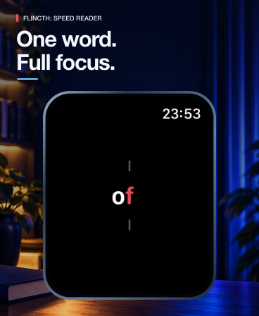

Speed Reader 1.1 adds an Apple Watch companion. It reads downloaded documents **one word at a time**. The Watch does not import files directly or offer the phone's phrase and sentence modes.

## Before you start

You need a Watch running **watchOS 10 or later**, paired with an iPhone running **iOS 17 or later**, and Speed Reader 1.1 or later on that iPhone. Install the companion using the iPhone's Watch app if it is not already installed. Watch support is included in Free; your existing Free or Pro reading limits apply. No extra subscription is required.

## Put a document in the Watch library

1. Add a supported DRM-free document to Speed Reader on the **paired iPhone**. PDFs need selectable text; protected books and scanned image-only PDFs are not supported.
2. Open Speed Reader on the Watch. Keep the paired iPhone nearby and open Speed Reader on it if the library has not appeared.
3. Tap **Refresh Library** on the Watch. Wait for the document list to update.
4. Tap the document you want to download. Keep the devices connected while it transfers, then open the downloaded document.

A title appearing in the list is not proof that its document has finished downloading. Check that it opens before leaving the phone behind.

If you added the document on an iPad, first let **Pro iCloud Sync** bring it to the paired iPhone. The Watch receives its copy from that iPhone, not directly from the iPad or iCloud.

## Read and control the pace

Watch reading uses word mode, with a highlighted focus letter and alignment guides. Tap the screen to pause and bring back controls. Use **Read** to continue and the **minus/plus** buttons to change the pace. The previous/next controls move between sentences; they do not change the display to sentence mode. Your Watch library displays reading progress.

## Read offline

Download the document while your paired iPhone is available. A downloaded copy can be read offline on the Watch. Refreshing the library or downloading another document still needs a connection to the paired iPhone. Open the downloaded document before going offline to make sure it is ready.

## If the library or download does not arrive

- Check that both devices have Speed Reader installed and that the iPhone has the document locally.
- Keep the paired iPhone nearby, open Speed Reader on it, then use **Refresh Library** again after the connection has had time to establish.
- If a transfer reports an error, retry that document while connected. Do not assume an undownloaded library entry is available offline.
- If a Free reading limit appears, try again after the daily allowance resets or manage Pro on the iPhone. Watch support itself has no separate charge.

For file-format problems, see the [document troubleshooting guide](/guides/ios/when-a-document-wont-open). For the broader workflow, read [your own documents on Apple Watch](/blog/read-your-own-documents-on-apple-watch), or return to [Speed Reader](/ios/speed-reader#apple-watch).
