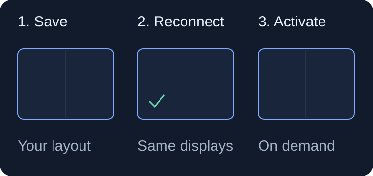

**To restore a saved window arrangement after reconnecting your monitors, reconnect the same displays, wait until macOS detects them, then activate the matching setup in Flincth Workspace Manager.** It applies your saved layout when you ask; reconnecting alone does not trigger it.

You need macOS 14 or later, the paid Mac App Store app, and the user-installed **Flincth Apply Shortcut**. Flincth works with ordinary windows on the current desktop, rather than moving windows between Spaces or into full screen.

<figure class="comparison-illustration"><figcaption>Concept illustration, not an app screenshot. Restoration is user-triggered.</figcaption></figure>

## First check your displays and windows

A disconnected display, a dock waking up or an app reopening can leave windows somewhere different from your saved arrangement. Check **System Settings → Displays** to make sure all expected screens are connected and arranged as you intend. Wait for a dock or monitor to finish waking before applying a layout.

macOS window tiling can help you arrange individual windows. Flincth adds a saved setup containing app placements and text clipboard context. If you only need to arrange one window, you may not need a separate saved setup. See [Mac window arrangement shortcuts](/guides/mac/window-arrangement-shortcuts).

## Save a setup for the displays you use together

1. Connect the laptop and external displays you want this setup to use.
2. Open **Workspace Manager…** from the Flincth menu bar icon and create a setup, such as *Desk*.
3. Select a screen, add placement regions with **Add Area** or a layout preset, and choose the app for each region. Repeat for the other screens.
4. Install the current **Flincth Apply Shortcut** using the app’s instructions. Flincth checks that the required helper is available before activation.
5. Activate the setup once and check the result. An app’s minimum window size or an unavailable window can prevent a placement; inspect the activation summary instead of assuming every window moved.

For the full walkthrough, use [Create Your First Setup](/guides/mac/create-your-first-setup) and [Install the Flincth Apply Shortcut](/guides/mac/install-the-flincth-apply-shortcut).

## Restore the layout after reconnecting

Reconnect the same displays and wait for macOS to recognise them. Choose the saved setup from the Flincth menu, use its assigned shortcut, or open **Quick Shifter** with <kbd>⌃⌥⌘S</kbd> and select it.

Activation places the setup’s available windows into their saved regions through the Shortcut and applies its app visibility rules. It also brings forward the setup’s text clipboard history. It does not continuously rearrange windows while you work.

[Learn Quick Shifter’s mouse and keyboard controls](/guides/mac/switch-setups-with-quick-shifter).

## Why is my setup unavailable?

Flincth requires a match with the setup’s saved displays. A missing saved display, an unmatched display or an extra connected screen prevents activation before apps are changed. Unavailable setups are hidden from the menu and Quick Shifter; the editor retains them for inspection and editing.

Check the cable, dock, input and **System Settings → Displays**, then reconnect the expected screens. Do not try to squeeze a two-display setup onto the laptop alone. Create a separate *Laptop* setup for that arrangement, and activate the setup that matches your current screens.

See [Layouts for Two Displays or an Ultrawide Monitor](/guides/mac/layouts-for-two-displays-and-ultrawide-monitors).

## Limits to check before relying on a layout

- **Mission Control desktops:** Flincth arranges ordinary windows on the current desktop. It does not move windows to another desktop.
- **Full screen:** leave macOS full screen before placing a window. Flincth does not enter or leave full screen for you.
- **Window sizes:** an app can enforce a minimum size larger than its saved region. Check reported placement failures.
- **Shortcut setup:** window placement needs the installed Flincth Apply helper. Optional one-step clipboard paste has a separate Accessibility permission; this is not a blanket permission-free promise.
- **Timing:** reconnect first, then activate. Flincth does not automatically restore a layout just because a display appears.

## Put a saved layout to work

[Get Flincth Workspace Manager on the Mac App Store]({{ site.data.mac.store_url }}). It is a one-time paid app with no subscription or trial; check your storefront for the current local price.

## Next

- [Restore your previous arrangement with Not Flincth](/guides/mac/restore-your-desk-with-not-flincth)
- [Example setups for coding, writing and meetings](/guides/mac/example-setups-for-coding-writing-and-meetings)
