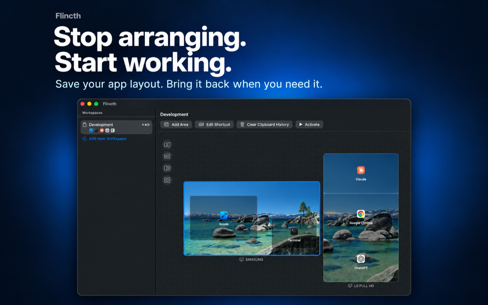
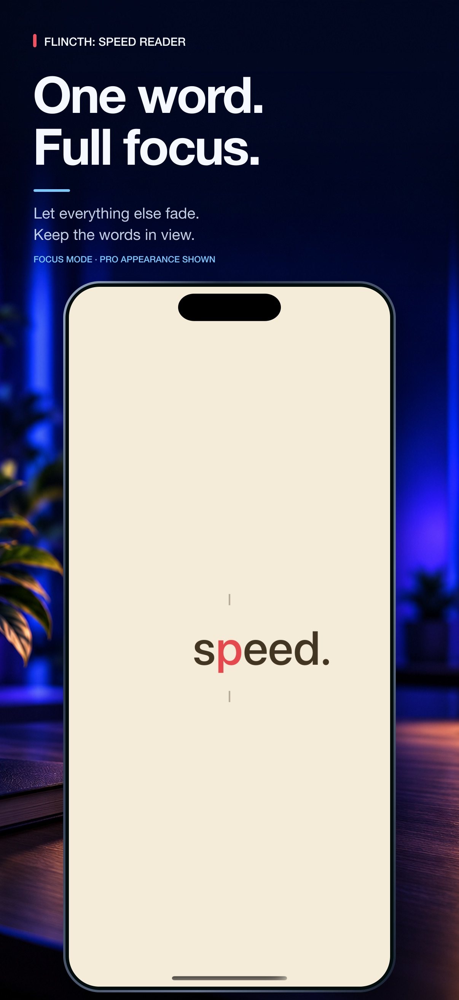

The awkward part of changing tasks is often getting ready to start. Your editor is behind a meeting window. The reference you need is in another tab. A document saved for later is still waiting on your phone.

A useful workflow gives each kind of work a small, repeatable starting point. You can build the habit with the apps you already use. We make Flincth tools that help with three parts of it: restoring a Mac desk, keeping browser sources together and reading your own documents on iPhone or iPad.

## Start with three kinds of work

Choose three tasks you actually repeat, such as coding, writing and meetings. For each, write down the apps you need, the windows you want visible and the next action that means you have started.

For coding, that might be an editor beside a browser, with a terminal below. For writing, it could be a document beside one reference. For meetings, keep the call and notes visible. Avoid opening everything in every setup: the point is to make the current task easier to begin.

Try arranging these desks manually first. If a layout does not help you work, saving it will not make it useful.

## Save the Mac desk you want to return to

[Flincth Workspace Manager](/mac/workspace-manager) stores named setups with app layouts and a separate text clipboard history for each. Switching setups changes the active desk and the clipboard context together. A copied writing reference does not have to share the same history as snippets from a coding session.

Install the **Flincth Apply** Shortcut during setup: it performs window placement. This is a layout applied when you switch, rather than continuous automatic tiling. Windows stay on their current Mission Control desktop, and Flincth does not enter or leave full screen for them.

Quick Shifter opens with **Control–Option–Command–S**. Choose a setup by its name and app icons; press Escape if you change your mind. See the [Quick Shifter walkthrough](/blog/meet-quick-shifter) for the details.

Start with one reliable layout on the displays you use today. Add another only when you have a recurring reason for it.

## Keep research sources beside the work

A browser workspace can help when you repeatedly compare sources or refer to a document while writing. Pick two or three panes with a clear job: source, comparison and notes, for example.

[Flincth Split View](/browser/split-view/) saves browser panes as workspaces. The extension is available for Chrome, Edge and Firefox. Website framing rules and signed-in sessions can affect what loads inside a pane; do not assume every site will embed. Use the supported real-window or launcher approach when a source cannot work inside the split view.

Keep the browser arrangement separate from your Mac setup. These are different products and saved configurations; switching one does not promise cross-product synchronisation.

## Give saved reading a specific next step

Choose one document before you stop working. A vague reading backlog is harder to return to than “read the next section of this PDF.” Use a short session and a comfortable pace, then pause to explain the important point in your own words.

[Flincth Speed Reader](/ios/speed-reader) opens your own DRM-free EPUB, PDF and DOCX documents on iPhone and iPad. Word, phrase and sentence modes give you different ways to display the text. Adjust the pace to the material, and return to difficult passages when needed. The app is a reading tool, not a guarantee of faster comprehension.

PDFs need selectable text: a scan without a text layer is not ready for this workflow. DRM-protected books are not supported. A web-page link is not a direct document import.

## Choose only the tool that solves your recurring problem

Workspace Manager is a paid Mac App Store download with a one-time purchase. Speed Reader is free to start, with a trial and optional one-time Pro purchase. Split View is a free browser extension. Purchases and features belong to each product; buying one does not unlock the others.

Check the relevant product page and your local store for current pricing and requirements. A temporary deal should support a useful choice, rather than decide which workflow you need.

Tomorrow, test one loop: switch to a prepared desk, work with the sources you need, then leave one document ready for a reading session. Keep the parts that make starting easier. You do not need to adopt all three tools at once.
