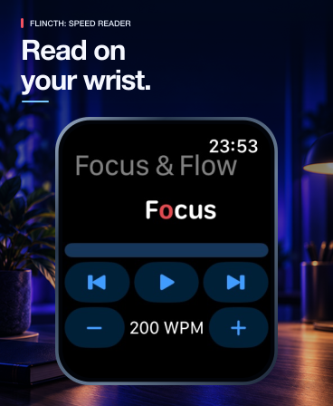
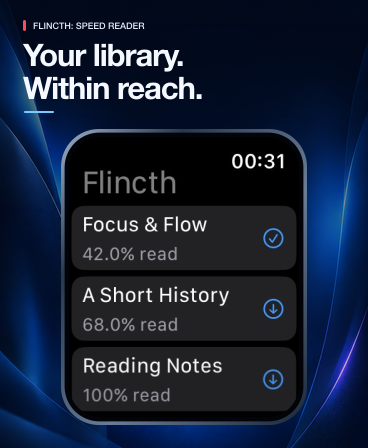

A short reading break does not always need a phone in your hand. A saved essay, a chapter or your own notes can be easier to return to when the next passage is already on your wrist.

Speed Reader 1.1 adds an Apple Watch companion to Flincth. You browse the documents supplied by your paired iPhone, download the ones you want and read a downloaded copy offline. Watch support is included in the free app, with your existing Free or Pro limits. It is a small companion for reading your own text, not a standalone bookstore or file importer.

## Start on the paired iPhone

The document starts in Speed Reader on your paired iPhone. Add a DRM-free EPUB, a PDF with selectable text, DOCX, TXT, RTF or Markdown file there. Copy-protected purchases and image-only scanned PDFs cannot be read. If a document fails to open on the phone, resolve that first: transferring it to Watch does not remove its format limitations.

You need iOS 17 or later on the paired iPhone and watchOS 10 or later on the Watch. Update Speed Reader to version 1.1 or later and install its Watch companion. This is an iPhone-to-Watch workflow; an iPad cannot pair with the Watch. If you keep documents on iPad, optional Pro iCloud Sync can bring them to your iPhone first.

## Choose a document before the break

Open Speed Reader on Watch and tap **Refresh Library**. Keep the iPhone nearby with Speed Reader installed; opening it on the phone can help establish the connection. The list shows your documents and their reading progress.

Tap the document you want to download and let the transfer finish. Open it while the phone is still nearby. That small check distinguishes a document that is merely listed from one whose text is actually ready on your wrist.

A downloaded copy can be read without keeping the phone connected. Refreshing the list or getting a new document still depends on the paired iPhone. Prepare the text before going offline rather than relying on an unfinished download.

## Keep the pace comfortable

On Watch, the reader displays **one word at a time**. A highlighted letter and alignment guides provide a fixed place to look. Phrase and sentence display modes are features of the iPhone and iPad app, not Watch reading modes.

Tap the screen to pause and reveal the reading controls. Use the minus and plus buttons to adjust words per minute, or the previous/next sentence controls to revisit a passage. Start at a pace that lets you understand the text; a higher number is not evidence of better comprehension.

For dense material, pause often or return to the larger phone or tablet display. Wrist reading suits a short passage you can give your attention to. It is not a reason to read while driving, crossing a road or doing another task that needs your eyes.

## Keep the plan simple

Watch support adds no new purchase and no subscription. Free keeps its existing reading limits; Pro remains an optional one-time upgrade. If you reach a limit, manage the plan on your iPhone. Documents from an iPad need to reach the paired iPhone through Pro iCloud Sync before the Watch can receive them.

Begin with one document and one short break. Check the download, choose a comfortable pace and see whether the small display fits the way you read. There is no need to move your whole library at once.

The [Watch setup and troubleshooting guide](/guides/ios/read-on-apple-watch) walks through the steps. See [Flincth Speed Reader](/ios/speed-reader#apple-watch) for the phone, tablet and Watch capabilities, or [get it on the App Store](https://apps.apple.com/app/id6827723552).
